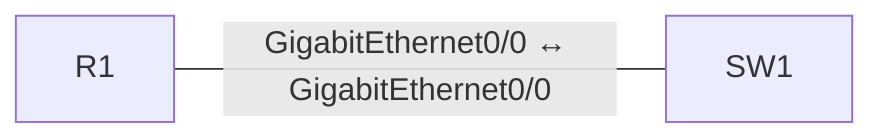

# VLANs And Router On A Stick

[Topology YAML](../../labs/200-301-ccna-implementing-and-administering-cisco-solutions/network-access/007-vlan-router-on-a-stick.yaml) · [Observed validation](../../validation/RESULTS.md)

## Scope and prerequisites

- Estimated study time: 35 minutes; difficulty: Beginner.
- CML 2.10.1 is the validation target; use licensed reference images matching the node types below.
- No external connector. Do not bridge these demo configurations into a home, work or public network.
- No application installation from the Internet is required for routing/switching labs.
- An imported topology is not a functional pass. Dated results and exact tested image IDs are in [runtime evidence](../../validation/README.md).

## Topology and node requirements

- **R1**: `iosv`.
- **SW1**: `iosvl2`.



## Starting state

The switch uses VTP transparent mode so the VLAN definitions in the startup
configuration are loaded reliably. A trunk allowing a VLAN is insufficient:
`show vlan brief` must also show VLANs 10 and 20 as active.

SW1 has routing enabled so its two SVI addresses can act as local diagnostic
probes. The acceptance pings verify each router subinterface over its VLAN;
they are not a proof of client-to-client inter-VLAN forwarding. For that
extension, use separate endpoint nodes with R1 as their default gateway.

The startup configuration is a working reference baseline. Establish the checks below before changing it; then implement the exercises and compare your results.

## Addressing

### R1

```text
interface GigabitEthernet0/0.10
 encapsulation dot1Q 10
 ip address 192.0.2.1 255.255.255.192
 exit
interface GigabitEthernet0/0.20
 encapsulation dot1Q 20
 ip address 192.0.2.65 255.255.255.192
 exit
```

### SW1

```text
interface Vlan10
 ip address 192.0.2.2 255.255.255.192
 no shutdown
 exit
interface Vlan20
 ip address 192.0.2.66 255.255.255.192
 no shutdown
 exit
```

## Exercises

1. Identify the 802.1Q subinterfaces and the /26 subnets.
2. Verify the trunk carries VLANs 10 and 20.
3. Remove VLAN 20 from the allowed list, prove the VLAN 20 failure, then restore it.

## Acceptance checks

| Node | Command | Expected result |
| --- | --- | --- |
| SW1 | `show vlan brief` | VLANs 10 and 20 exist and are active. |
| SW1 | `show interfaces trunk` | Gi0/0 is trunking with VLANs 10 and 20. |
| SW1 | `ping 192.0.2.65 source Vlan20 repeat 3` | VLAN 20 reaches its router subinterface. |
| SW1 | `ping 192.0.2.1 source Vlan10 repeat 3` | VLAN 10 reaches its router subinterface. |

## Reset and troubleshooting

Stop, wipe and restart **only this lab** to restore its checked-in startup configuration. Save your own configuration first if needed. Check interface state, addressing and routing before changing protocols. A failed ping alone does not identify the fault.
