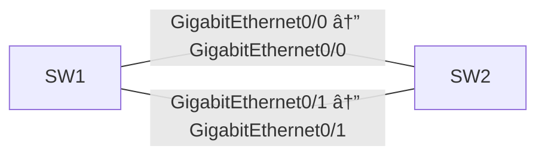

# STP Root Selection

[Topology YAML](../../labs/200-301-ccna-implementing-and-administering-cisco-solutions/network-access/009-stp-root-selection.yaml) · [Observed validation](../../validation/RESULTS.md)

## Scope and prerequisites

- Estimated study time: 35 minutes; difficulty: Beginner.
- CML 2.10.1 is the validation target; use licensed reference images matching the node types below.
- No external connector. Do not bridge these demo configurations into a home, work or public network.
- No application installation from the Internet is required for routing/switching labs.
- An imported topology is not a functional pass. Dated results and exact tested image IDs are in [runtime evidence](../../validation/README.md).

## Topology and node requirements

- **SW1**: `iosvl2`.
- **SW2**: `iosvl2`.

## Starting state

The startup configuration is a working reference baseline. Establish the checks below before changing it; then implement the exercises and compare your results.

## Layer 2 configuration

No IP addressing is needed. Both switches use VTP transparent mode and VLAN 10.
SW1 has priority 4096; SW2 keeps its default priority. Two parallel trunks allow
you to observe the forwarding and alternate ports without creating a loop.

## Exercises

1. Identify the root bridge and explain its priority.
2. Identify the root port and alternate port on SW2.
3. Shut the root port, verify the alternate forwards, then restore the port.

## Acceptance checks

| Node | Command | Expected result |
| --- | --- | --- |
| SW1 | `show spanning-tree vlan 10` | SW1 is the root bridge. |
| SW2 | `show spanning-tree vlan 10` | SW2 has one alternate blocking link. |

## Reset and troubleshooting

Stop, wipe and restart **only this lab** to restore its checked-in startup configuration. Save your own configuration first if needed. Check interface state, addressing and routing before changing protocols. A failed ping alone does not identify the fault.
