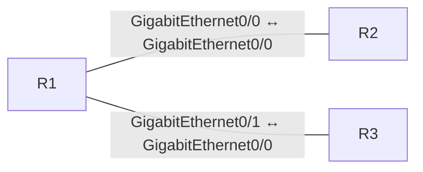

# BGP Path Selection Local Pref MED

[Topology YAML](../../labs/300-410-enarsi-implementing-cisco-enterprise-advanced-routing-and-services/bgp/014-bgp-path-selection-local-pref-med.yaml) · [Observed validation](../../validation/RESULTS.md)

## Scope and prerequisites

- Estimated study time: 45 minutes; difficulty: Intermediate.
- CML 2.10.1 is the validation target; use licensed reference images matching the node types below.
- No external connector. Do not bridge these demo configurations into a home, work or public network.
- No application installation from the Internet is required for routing/switching labs.
- An imported topology is not a functional pass. Dated results and exact tested image IDs are in [runtime evidence](../../validation/README.md).

## Topology and node requirements

- **R1**: `iosv`.
- **R2**: `iosv`.
- **R3**: `iosv`.



## Starting state

The startup configuration is a working reference baseline. Establish the checks below before changing it; then implement the exercises and compare your results.

## Addressing

### R1

```text
interface GigabitEthernet0/0
 ip address 198.18.0.1 255.255.255.252
 no shutdown
 exit
interface GigabitEthernet0/1
 ip address 198.18.0.5 255.255.255.252
 no shutdown
 exit
```

### R2

```text
interface GigabitEthernet0/0
 ip address 198.18.0.2 255.255.255.252
 no shutdown
 exit
interface Loopback0
 ip address 203.0.113.2 255.255.255.0
 no shutdown
 exit
```

### R3

```text
interface GigabitEthernet0/0
 ip address 198.18.0.6 255.255.255.252
 no shutdown
 exit
interface Loopback0
 ip address 203.0.113.3 255.255.255.0
 no shutdown
 exit
```

## Exercises

1. Verify that two paths to 203.0.113.0/24 exist.
2. Explain why local preference 200 selects R3.
3. Apply a higher preference to R2, refresh inbound routes and verify the change.
4. Explain why MED across these different neighboring ASes is not compared by default.

## Acceptance checks

| Node | Command | Expected result |
| --- | --- | --- |
| R1 | `show ip bgp 203.0.113.0` | The path through 198.18.0.6 has local preference 200 and is best. |
| R1 | `show ip route 203.0.113.0` | The forwarding route uses R3. |

## Reset and troubleshooting

Stop, wipe and restart **only this lab** to restore its checked-in startup configuration. Save your own configuration first if needed. Check interface state, addressing and routing before changing protocols. A failed ping alone does not identify the fault.
