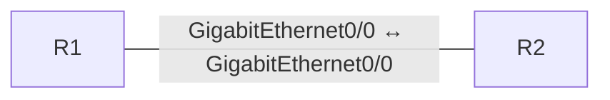

# OSPFv2 Neighbor Troubleshooting

[Topology YAML](../../labs/200-301-ccna-implementing-and-administering-cisco-solutions/ip-connectivity/018-ospfv2-neighbor-troubleshooting.yaml) · [Observed validation](../../validation/RESULTS.md)

## Scope and prerequisites

- Estimated study time: 35 minutes; difficulty: Intermediate.
- CML 2.10.1 is the validation target; use licensed reference images matching the node types below.
- No external connector. Do not bridge these demo configurations into a home, work or public network.
- No application installation from the Internet is required for routing/switching labs.
- An imported topology is not a functional pass. Dated results and exact tested image IDs are in [runtime evidence](../../validation/README.md).

## Topology and node requirements

- **R1**: `iosv`.
- **R2**: `iosv`.



## Starting state

**Deliberate fault:** R1 uses area 0 and R2 uses area 1 on the same link.

## Addressing

### R1

```text
interface GigabitEthernet0/0
 ip address 198.18.0.1 255.255.255.252
 no shutdown
 exit
interface Loopback0
 ip address 192.0.2.1 255.255.255.255
 no shutdown
 exit
```

### R2

```text
interface GigabitEthernet0/0
 ip address 198.18.0.2 255.255.255.252
 no shutdown
 exit
interface Loopback0
 ip address 192.0.2.2 255.255.255.255
 no shutdown
 exit
```

## Exercises

1. Prove Layer 3 reachability on the transit network.
2. Find the OSPF area mismatch without resetting devices.
3. Repair R2 and prove loopback reachability.

## Acceptance checks

| Node | Command | Expected result |
| --- | --- | --- |
| R1 | `show ip ospf neighbor` | No FULL neighbor before repair; FULL after repair. |
| R1 | `ping 192.0.2.2 source Loopback0 repeat 3` | Loopback ping passes after repair. |

## Reset and troubleshooting

Stop, wipe and restart **only this lab** to restore its checked-in startup configuration. Save your own configuration first if needed. Check interface state, addressing and routing before changing protocols. A failed ping alone does not identify the fault.

<details><summary>Instructor repair (spoiler)</summary>

```text
configure terminal
router ospf 10
no network 198.18.0.0 0.0.0.3 area 1
no network 192.0.2.2 0.0.0.0 area 1
network 198.18.0.0 0.0.0.3 area 0
network 192.0.2.2 0.0.0.0 area 0
end
```

</details>
