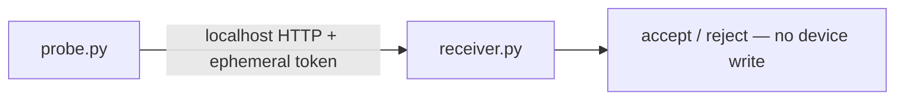

# Webhook Receiver Config Validation

[Topology YAML](../../labs/350-901-devcor-developing-applications-using-cisco-core-platforms-and-apis/webhooks/035-webhook-receiver-config-validation.yaml) · [Observed validation](../../validation/RESULTS.md)

## Scope

Strict intent validation, allowlists and a safe approval boundary. This is a **mock, read-only intent workflow**. It does not connect to a network controller, run router commands, or apply configuration. A successful 202 means accepted for the exercise, not applied to a device.

This workbook remains under its original DEVCOR path for stable links. See [the certification mapping](../CERTIFICATIONS.md) before using it for current AUTOCOR study.

## Requirements and topology

- CML 2.10.1 validation target, one Ubuntu 24.04 reference VM, 2 GiB nominal RAM plus controller overhead.
- Python 3 is included in the Ubuntu image. No Internet downloads, package installation or external connector are used.
- One isolated `DEVBOX`, no links. The receiver binds to `127.0.0.1:8080` only.
- Serial-console root autologin is deliberately configured for this disposable teaching VM. Do not add an external connector or reuse this guest as a production server.
- A new secret is generated at first boot in `/run/cml-webhook.env`; never commit or share it. Wipe/restart for a new disposable instance.



## Start and observe

1. Import the YAML and start DEVBOX. Open its serial console.
2. Wait for `CML-LABS-READY` and the root shell. The bootstrap config installs the example files directly from this repository into the guest.
3. Run `systemctl is-active cml-webhook.service`; expect `active`.
4. Run `python3 /opt/cml-webhook/probe.py`; expect `"passed": 6` and `"device_changes": 0`.
5. Inspect `/var/log/cml-webhook-acceptance.json` for the boot-time probe result.

## Contract

`POST /events` requires `Content-Type: application/json` and an `Authorization: Bearer <ephemeral secret>` header. Use a fresh event ID for each new event.

```json
{"event_id":"exercise-001","device":"R1","interface":"Loopback0","enabled":true}
```

Allowed devices are R1/R2; interfaces are GigabitEthernet0/0, GigabitEthernet0/1 and Loopback0. `enabled` must be a JSON boolean, not a string. The receiver rejects extra fields and limits the request body to 8192 bytes.

## Acceptance matrix and exercises

| Case | Expected HTTP status | Why |
| --- | ---: | --- |
| Invalid token | 401 | Authentication precedes acceptance |
| Valid, new intent | 202 | Accepted; `applied` remains false |
| Exact duplicate event | 200 | Idempotent within the current process cache |
| Same ID, changed payload | 409 | Ambiguous replay is rejected |
| Unknown interface | 422 | Allowlist enforcement |
| String `"true"` | 422 | Strict type enforcement |

Modify a **copy** of the probe to test malformed JSON (400), oversized content (413) and an unknown route (404). Explain how authentication differs from payload validation. Add a unit test before extending the device/interface allowlist. Describe where a human approval and a separately scoped device writer would belong; do not turn this mock into a production writer.

## Limits and reset

This educational service uses cleartext HTTP on loopback, an in-memory cache of the last 1000 event IDs and no durable queue. A restart forgets deduplication. It is not a production webhook gateway or SOAR system. Stop/wipe **only this lab** to reset the exercise. Dated functional results are recorded in [validation](../../validation/README.md).
